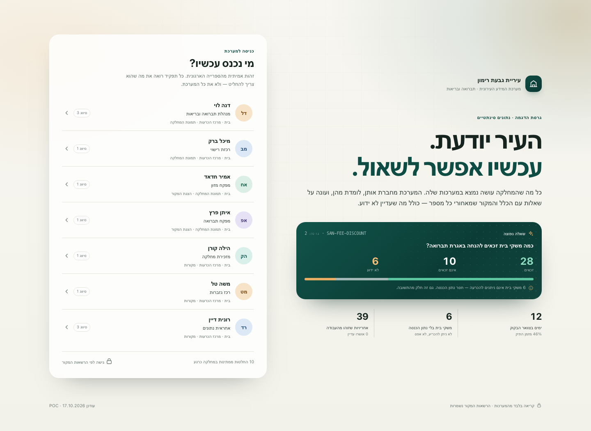
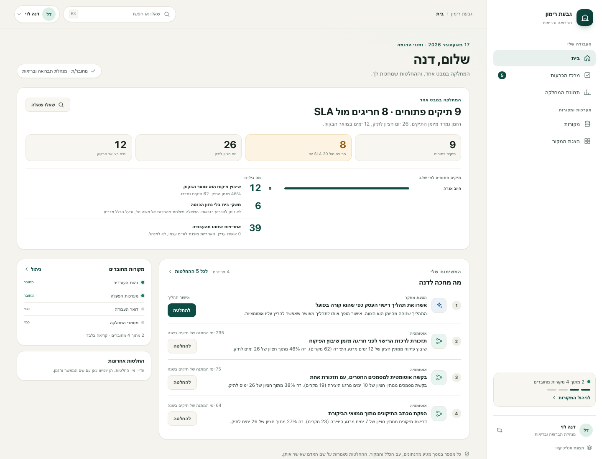
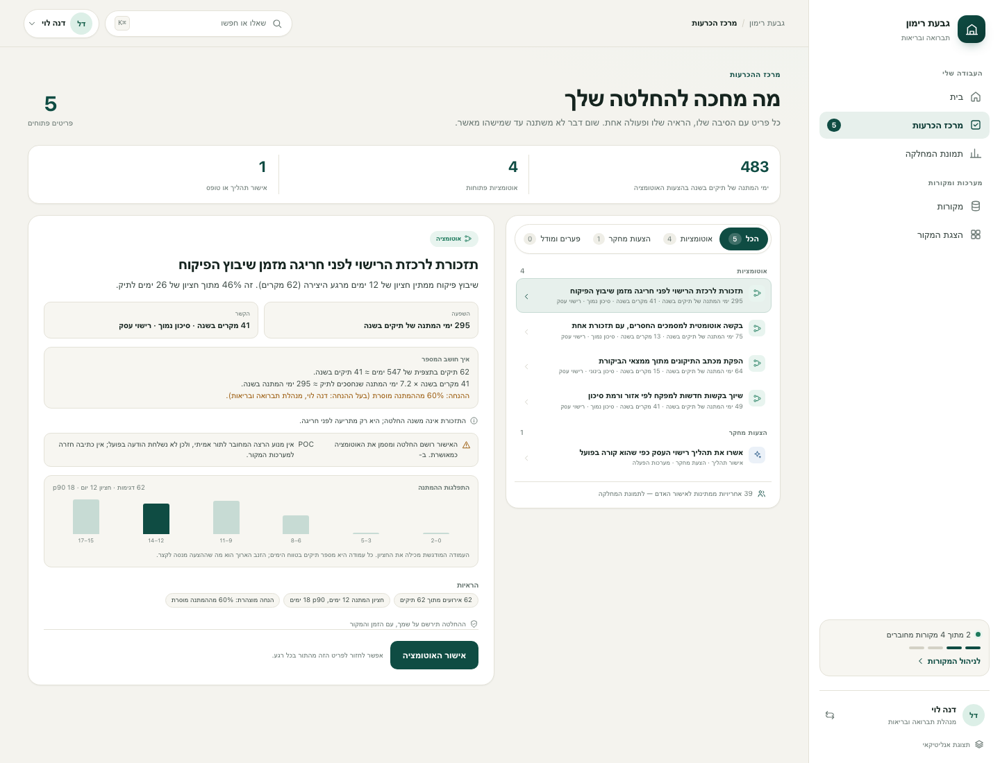
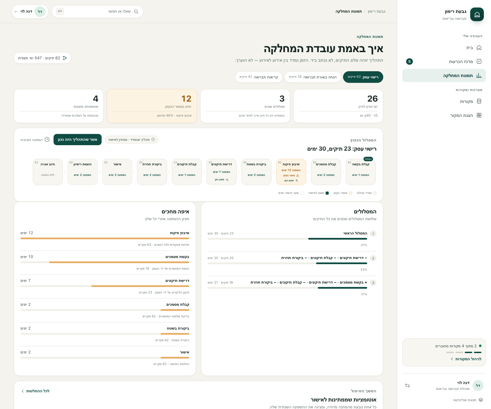
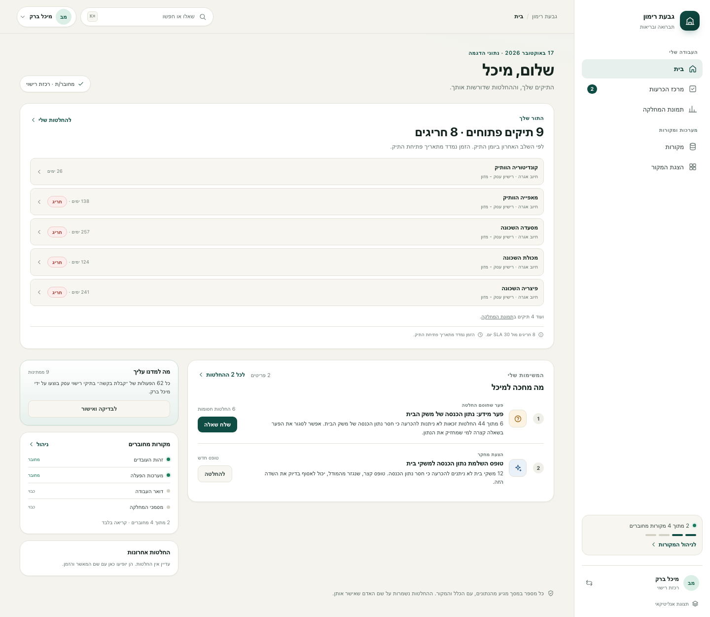
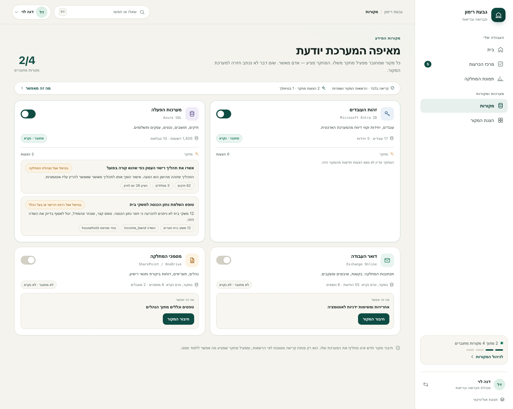
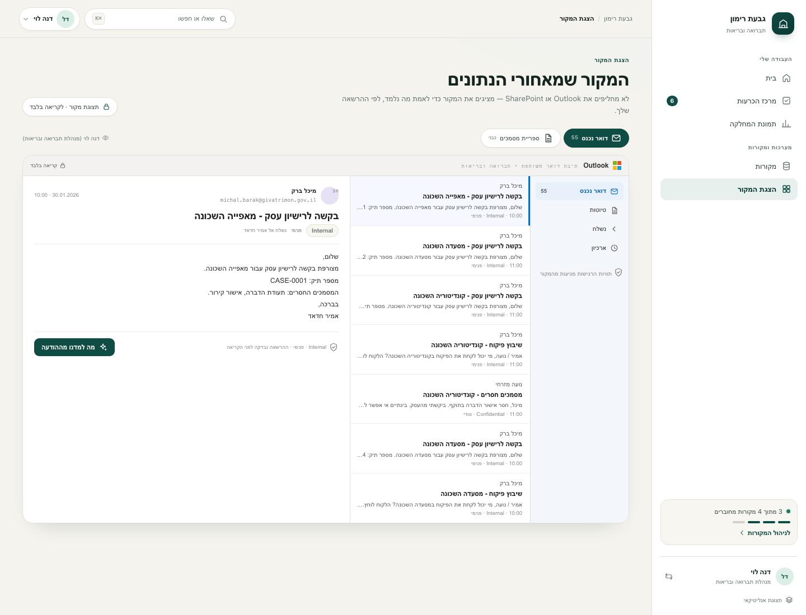

# Municipal data platform POC

A proof of concept for a municipality on Microsoft cloud: a system that maps and learns the organization (structure, ontology,
workflows), fills its own gaps, answers questions from the data, and grows automations.

**Scope:** the Sanitation & Health department (תברואה ובריאות) of the fictional City of Givat Rimon, across three services —
food-business health licence, sanitation-fee discount, and sanitation/pest complaints. A second, deliberately different
municipality (Kiryat Gefen) is onboarded from the first one's graph to show what reusing the model actually saves.

- Design brief: [docs/DESIGN.md](docs/DESIGN.md)
- Build plan and board: [docs/board/README.md](docs/board/README.md) · [project board](https://github.com/users/shaharAka/projects/3)
- Decisions: [docs/decisions](docs/decisions) — start with [ADR-0001](docs/decisions/0001-runtime-and-substitutes.md) and [ADR-0006](docs/decisions/0006-adopt-the-aka-ontology-engine.md)

## Run it

Nothing to install. Node 22.18+:

```bash
npm run demo   # the whole loop, narrated in the terminal with real numbers
npm start      # the product at http://127.0.0.1:4173
npm test       # 40 tests over the pipeline, the ontology, eligibility, forms, interviews and access
```

Open <http://127.0.0.1:4173> and choose one of the seven people from the
directory. The signed-in product has five movements:

- **Home** — a role-shaped first block: the head sees department health against
  SLA and three findings, the coordinator her case queue, the food inspector her
  food inspections, the field inspector the record the source does not assign to
  her, the rule owner the questions sent to him, the data steward the model
  additions. Then the few things that actually need the person. One
  question surface lives in the top bar (`⌘K`), so the fee-discount answer is a
  scenario, not everyone's opening screen.
- **Decisions** — a queue and a detail pane, filtered by owner: automations and
  process validation to the department head, form research to the coordinator
  and the rule owner, gaps to the coordinator and the rule owner, rule changes
  to the rule owner, model additions only to the data steward. One decision, one
  approver, one recorded decision; the detail carries the formula, the wait
  distribution, the assumption and its owner, and what approval actually does.
- **Department picture** — the measured licence process, its variants and
  bottleneck, the organisation map, and automation proposals in place.
- **Sources** — each source is a permission. A staff-data source opens a consent
  sheet first (scope, legal/IT approvers, DPIA status, staff opt-out). Connecting
  it runs research; suggestions route to their owner's decisions, never a second
  approve button. A generated form opens, prefills from the chosen record, and
  saves with provenance.
- **Source viewer** — Outlook and a SharePoint library as the department knows
  them, only when the source is connected, with a Hebrew gloss on source labels
  and source access preserved. A fact's "show in source" deep-links back to the
  message or document.

The eligibility question — *how many households are eligible for the
sanitation-fee discount?* — answers with 28 eligible, 10 not eligible and
**6 unknown**, the approved rule version and its citation, and the missing
attribute (household income) already turned into a gap and an interview. Unknown
is never folded into zero.

The experience decisions and the role-shaped information architecture are in
[docs/UX.md](docs/UX.md). The four click-through scenarios are in
[docs/USE-CASES.md](docs/USE-CASES.md). What changed after the product/UX review,
and what is deliberately still open, is in
[docs/REVIEW-product-ux-response.md](docs/REVIEW-product-ux-response.md).






## What it actually does

**1 · Mock the real cloud, do not invent it.** `src/cloud/mock-azure.ts` serves
the shapes the platform would speak in production: Microsoft Graph paths
(`/v1.0/users`, `/users/{id}/messages`, `/drives/{id}/items`, `/permissions`),
OData envelopes (`value`, `@odata.nextLink`, `@odata.deltaLink`), Bearer auth for
Graph and `api-key` for Azure OpenAI, Purview sensitivity labels, and an
Azure SQL stand-in whose results match the `mssql` driver's shape. Swapping the
mock for the real service is a base URL, a credential and a deployment name —
[src/cloud/registry.ts](src/cloud/registry.ts) lists both sides of every row.

**2 · Map into the ontology, not into tables.** ([src/ontology](src/ontology))
Ontology packs are composed into a baseline, then a tenant overlay is applied —
the model from the AKA ontology engine (`aka-food/aka-new-platform`), see
[ADR-0006](docs/decisions/0006-adopt-the-aka-ontology-engine.md). Page types,
edge kinds, JSON-Schema properties and required fields; unknown properties are
refused. [mappings.ts](src/ontology/mappings.ts) is the declarative answer to
"where does this value come from": source → page type → property, with
transforms and a declared acceptance rule.

**3 · Every value carries provenance.** ([src/graph/graph.ts](src/graph/graph.ts))
Facts are versioned, never overwritten, and point at evidence with an exact
locator (row + column, message + span, file + page). A fact from a system of
record is confirmed by declared rule R-001; anything a model reads stays a
candidate. Source columns with no ontology property become `knowledge_candidate`
pages — proposals a person accepts or rejects, never a silent schema change.

**4 · The organization map is inferred, then confirmed.** ([src/org](src/org))
Units come from the directory, heads from the reporting lines, and
responsibilities from the work traces: which case events a person performs, which
topics they are on in mail. An inference is a candidate with the count it rests
on ("62 of 290 recorded actions"), not a percentage score.

**5 · Workflows are discovered, not written.** ([src/process](src/process))
Cases become traces; traces become variants; waits are measured between
consecutive events. On the demo data the licence process has three variants,
a 26-day median case, and a bottleneck at inspection scheduling: 12 days,
46% of the total wait. Automation proposals follow from that with declared
parameters and stated assumptions — see `PARAMS` in
[discover.ts](src/process/discover.ts).

**6 · Answers keep their unknowns.** ([src/query](src/query)) A question becomes a typed plan, never SQL. The
executor applies the rule version in force, per household, and returns three counts plus the reason each unknown is
unknown. Counts below the declared minimum cell size are suppressed. Every answer is stored as a `query_answer` page
with its plan, so it can be re-checked when the data or the rule changes. Unknowns become `knowledge_candidate` gaps.

**7 · Forms are generated, and gaps are closed by asking.** ([src/forms](src/forms), [src/interviews](src/interviews))
A form is three documents derived from one page type: JSON Schema, UI schema and an Adaptive Card. Validation runs
against the generated schema, so a form cannot drift from the model. The gap queue picks the person from the org map
and generates at most five prefilled questions — one open interview per person, declining allowed. An answer becomes
evidence, and an answer that contradicts the rule becomes a **proposed rule change with its what-if counts** (28
eligible / 16 not eligible / 0 unknown, versus 28 / 10 / 6 today) that the rule owner still has to approve.



**8 · The next municipality is a diff.** ([src/template](src/template))
The learned graph exports a versioned template (units, roles, services, process
shapes). Onboarding compares a new organization to it and reports matched,
renamed, added and missing — with an overlay draft recording only the
differences. See [ADR-0007](docs/decisions/0007-reuse-the-graph-for-the-next-municipality.md).




## Numbers from the demo data

| | |
|---|---|
| Pages / edges / facts | 1,578 / 2,640 / 8,182 |
| Facts confirmed by rule / candidate | 7,508 / 674 |
| Licence cases analysed | 62 over 547 days, 3 variants |
| Median licence case | 26 days (p90 35) |
| Bottleneck | inspection scheduling, 12-day median wait |
| Proposed automations | 4, led by an SLA reminder (295 applicant waiting days/yr) |
| Template diff | units 80%, roles 38%, process steps 73% |

## Layout

```
src/
  cloud/        Graph, Purview, Azure SQL, Azure OpenAI — the real shapes, locally
  ontology/     packs (JSON), composer, declarative source mappings
  graph/        pages, edges, the fact ledger, access mirroring
  ingest/       mapping execution: pages, facts, edges, candidates
  org/          units, heads, inferred responsibilities
  process/      variants, waits, bottlenecks, automation proposals
  template/     export, diff, overlay draft
  web/          the product (home.js, views.js, ui.js) and the analyst workbench (app.js)
  server.ts     HTTP API + static
  demo.ts       the loop in a terminal
```

The experience itself — information architecture, visual system, RTL rules and
states — is specified in [docs/UX.md](docs/UX.md).

## Honest limits

- **Synthetic data.** Fixed seed, fictional people and addresses (ADR-0003). The
  Graph and SQL clients are exercised against fixtures; the real endpoints have
  not been called from this repo.
- **The local model is a stand-in.** Behind the Azure OpenAI protocol, extraction
  is rule-based and deterministic so evals can assert exact output. It says
  nothing about model quality; the role benchmark is a P2 task, not done here.
- **Discovery is variant-based, not a full inductive miner.** Traces are collapsed
  and grouped; fitness/precision against a holdout log is not computed yet.
- **No writes back.** Read-only, per the brief. The only writes are to the POC's
  own graph.
- **Identity is a demo control, not a sign-in.** `?role=<id>` restores a session
  and the API enforces the viewer's source access; there is no OIDC flow, session
  token or audit of the actor's real identity. Slice 0 owns that.
- **The interface is the POC's argument, not a shipped product.** Mobile, RTL and
  keyboard paths are covered by the screens and the `prefers-reduced-motion`
  rules; there is no browser-matrix run in CI.
- **The assistant is a router.** Questions without a declared metric fall back to
  search over mail, documents, the graph and rules. It does not write free SQL
  and it does not call a general model for prose. A question with an
  unsupported filter is refused with the interpretation shown; the planner does
  not silently drop the filter. Case status and complaint counts are supported;
  complaint filters (month, pest type) are not.
- **Automation approval records a decision; it does not run a production job.**
  The detail pane says so. There is no queue consumer or outbound reminder in the
  POC; the execution engine is a later slice.
- **Source consent is a POC gate, not a legal signature.** The consent sheet
  shows the scope, named approvers, DPIA status and staff opt-out, and blocks the
  toggle; no approval record is signed or persisted as a legal artefact.
- **The field inspector has no assigned inspections in the fixture.** The
  licence cases name the food inspectors as actors; the sanitation side has no
  per-inspector assignment. The field home says that instead of inventing a
  queue, so it opens on zero. This is a data gap a real deployment would close
  with the assignment field the source does not have.
- **The source viewer is read-only and connection-gated.** A disconnected mail
  or document source shows a gate, and search does not return its items. The
  mailbox is labelled as the department's shared mailbox, because the fixtures
  model a shared mailbox, not a personal one.
