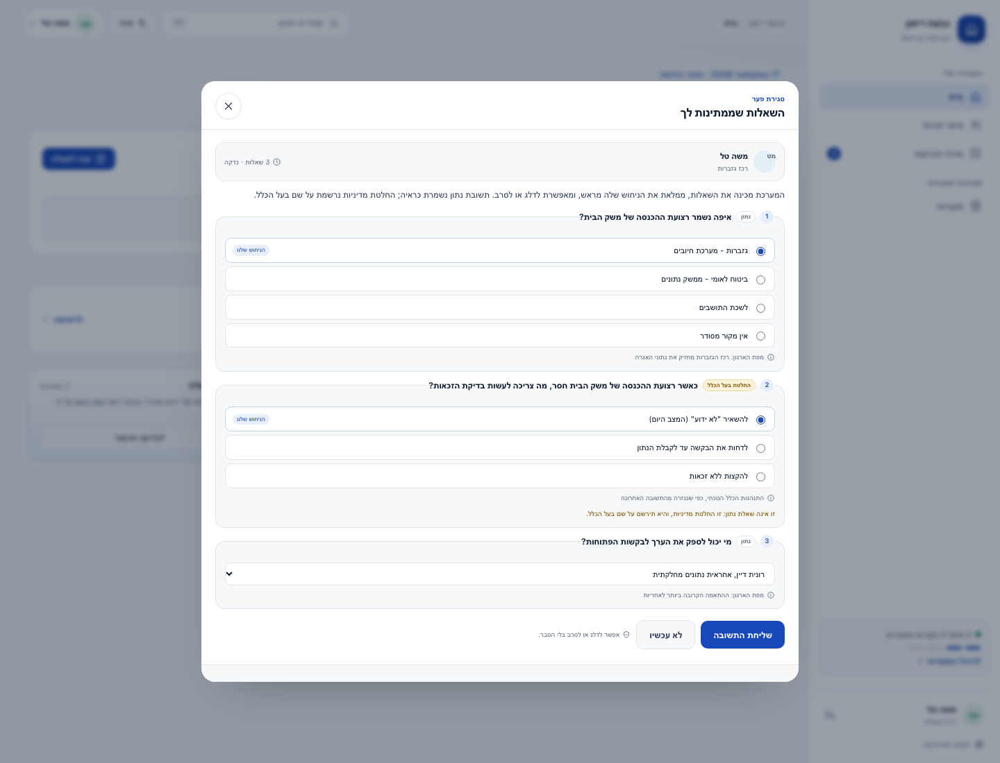

# Use cases the demo walks through

Four scenarios, chosen because each one removes a specific daily pain in the
Sanitation & Health department. Every step is a real click against the demo
graph; the data is synthetic, the interaction is not. The demo starts at `/`:
choose one of the seven people from the directory, and the product opens as
that person. Each role has a different first block at home.

The **סיור** button in the top bar (and **סיור מודרך** on the landing page) opens
the four scenarios below. Each switches to the owning role and opens the real
screen at the right place. A three-step coach stays at the bottom; **הבא** and
**חזור** move it and highlight the next target. Nothing is a separate simulated
walkthrough.

The main surface has five movements: **home** (a role-shaped first block and
what needs attention), **decisions** (a queue and a detail pane), **department
picture** (the measured process and the org map), **sources** (permissions and
research), and **source viewer** (the Microsoft tools the department already
uses, when connected). Each role sees only the movements it acts on.

## The test every scenario must pass

A clerk or a department head should be able to answer, after one pass:

1. **What did I not have to do?** (search a system, ask a colleague, build a spreadsheet)
2. **What did the system decide?** (nothing that changes how the city works)
3. **What is it waiting for me to decide?**

If a screen cannot answer all three, it is complexity we added, not removed.

## 1 · Eligibility — "how many households qualify?"

| | |
|---|---|
| Pain today | The question goes to finance; someone opens a spreadsheet, joins two extracts by hand, and answers three days later without saying what they could not check. |
| What the system does | 28 eligible, 10 not eligible, **6 undecidable** — with the approved rule version, its citation and owner, and the attribute that blocked each unknown. The derivation is behind one button, not a second screen. |
| Where | Landing (the flagship answer) or top bar (`⌘K`) → ask → **איך חושב**. The head's home opens on department health, not on this answer. |
| Clicks | Choose your identity, then ask from the one question surface. |
| Why it is simpler | The answer arrives with its own audit trail. Nobody has to reconstruct *how* the number was reached, and nobody is tempted to round the unknown away. |

## 2 · The gap — "who can close the missing six?"

| | |
|---|---|
| Pain today | Nobody knows who owns the income attribute, so the gap survives every renewal cycle. |
| What the system does | The home screen ranks the gap as a task. Opening it sends three prefilled questions to the finance liaison (chosen from the org map). The answer becomes evidence, and a contradiction with the rule becomes a **rule-change proposal with what-if numbers** (28 / 16 / 0) in the decisions queue — still waiting for the rule owner. |
| Where | The licensing coordinator's home → gap → **שלח שאלה**. The rule owner sees the question arrive, answers it, and the policy answer is recorded as their decision. The sender never answers for them. |
| Clicks | Send, then answer. Two more clicks. |
| Why it is simpler | The interview is three questions with the best guess already filled. The person confirms or corrects rather than composing an answer, and the change still waits for the rule owner. |

## 3 · A new source — "what happens when we connect mail?"

| | |
|---|---|
| Pain today | Connecting a system is an IT project measured in months, and the first output is usually a dashboard nobody asked for. |
| What the system does | Enabling work email runs its own research and returns suggestions with evidence: 39 inferred responsibilities and a missing step in the licence process. The source card shows what was found. Responsibilities can be approved by the people they describe in their own review, not by a manager in a bulk click. |
| Where | Sources → the source opens a consent sheet (scope, legal/IT approvers, DPIA, staff opt-out) → connect. Research suggestions link to the owner's decisions; responsibilities are confirmed by the person via **מה למדנו עליך**. |
| Clicks | Consent, connect, then confirm. |
| Why it is simpler | The source does not need a specification up front. It produces proposals a person can accept in one click, and the proposals arrive with the reason attached. |

## 4 · A form — "the form changes, now what?"

| | |
|---|---|
| Pain today | Every field change is a development ticket, and the form drifts from the rules it is supposed to enforce. |
| What the system does | Approving a form suggestion creates a form from the page type. **פתיחה** opens the real generated form, prefilled from the chosen record, in Hebrew. Saving validates against the generated schema and writes the values onto the record with provenance. |
| Where | The income-form suggestion in Decisions (the coordinator or rule owner) → approve → Sources → the new form card → **פתיחה** → choose the record → save. The suggestion closes the gap shown on the same home. |
| Clicks | Approve, open, fill, save. |
| Why it is simpler | The form cannot contradict the model because both come from the same source. A new field is a model change, not a form rewrite. |

## What stays human, by design

- No eligibility rule changes without its owner.
- No automation runs before approval.
- No ontology change is applied by the system; proposals become a namespaced overlay when a person accepts them.
- Inferred responsibilities are confirmed or corrected by the person they describe; the manager does not bulk-approve them.
- The interview is sent by the coordinator and answered only by its recipient; the policy answer is the rule owner's decision.
- Model additions go to the data steward, not to the department head.
- Every unknown keeps a name and a next step instead of becoming a zero.

## Still open — decide before the first external demo

1. Should the unknown bucket be resolved by policy (as scenario 2 proposes) or by collecting documents from residents?
2. Is "one open interview per person" the right ceiling, or three questions a week?
3. Should the ontology steward see model additions in the decisions queue, or only in the analyst workbench? Today the queue shows them with a one-click overlay.
