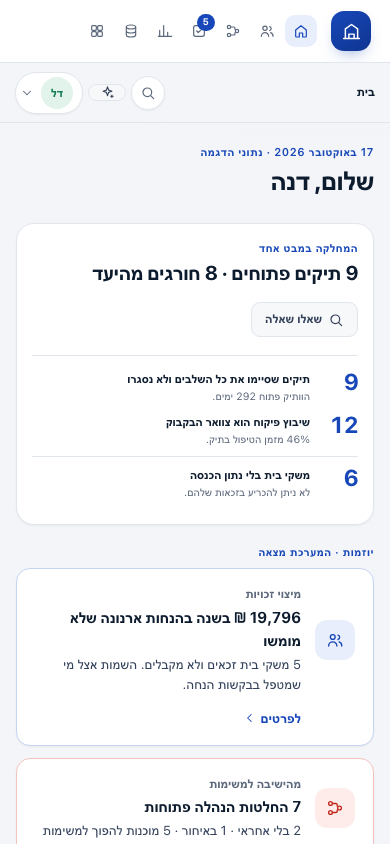

# The experience: one person, one question, one decision at a time

Status: design for the signed-in surface, October 2026. The screens are in
`src/web/` and are served by `npm start`.

The product has four jobs. The interface has to make them obvious without
explaining the architecture first:

1. **Answer a question** the department already asks, with the rule and the
   unknowns attached.
2. **Put the few real decisions in front of the person** who can make them —
   and keep everything else out of the way.
3. **Show the work** when asked: source, locator, rule version, evidence.
4. **Make the next municipality cheaper** by showing what the model already
   knows.

Everything that follows is in service of those four sentences.

## The test every screen must pass

After one pass a clerk or a department head should be able to answer:

- **What did I not have to do?** (search a system, ask a colleague, build a
  spreadsheet)
- **What is the system waiting for me to decide?**
- **What can I check myself?** (the rule, the source, the evidence)

A screen that cannot answer all three is complexity we added, not removed.

## One identity, not a viewer picker inside the product

The person signs in once. The identity comes from the directory and determines:

- what the menu contains,
- what the home screen puts first,
- which documents and facts the API returns.

`?role=<viewer-id>` restores a session for the demo. It is not a control inside
a screen. Switching identity is one action in the side rail, and it re-fetches
everything under the new access rules.

## Information architecture

The signed-in surface is a side rail plus one work area; on a phone the rail
becomes a compact top strip and the icon-only destinations keep their labels for
screen readers. Nav is role-shaped:

| Role | First block on home | Sees |
|---|---|---|
| Department head | Department health: open cases, overdue against SLA, stage mix, bottleneck, findings | Home · Decisions · Department picture · Sources · Source viewer |
| Licensing coordinator | Her case queue, oldest and overdue first | Home · Decisions · Department picture · Sources · Source viewer |
| Food inspector | Her food-business inspections and the businesses waiting for one | Home · Department picture · Source viewer |
| Field inspector | Inspections she performed and open inspection cases; the source has no personal assignment, and the screen says so | Home · Department picture · Source viewer |
| Rule owner (treasury) | Open questions sent to them, the rule in force, gaps | Home · Decisions · Sources |
| Data steward | Model additions waiting, model coverage | Home · Decisions · Sources |
| Secretary | Open cases and documents, no decisions she does not own | Home · Decisions · Sources · Source viewer |

Home is not a question surface. The top bar is the single place to ask, and the
separate "Ask" page is gone. A role that does not act on approvals does not get
a decisions tab.

## Screens

### Landing

A real door, not a splash screen. The right side says what the system is and
shows one live answer (28 eligible / 10 not / 6 unknown) with the rule behind
it, plus three findings rather than internal graph counts. The left side lists
the seven real people from the directory, what each one will see, and their
clearance. No fake avatars, no invented job titles.

### Home

The home is a role-shaped first block, then the attention list, then the rail:

1. **A role first block.** The head gets department health and findings; the
   coordinator her case queue; the inspector inspections; the rule owner their
   questions; the steward model additions. No role opens on the fee-discount
   answer.
2. **The attention list.** At most four ranked items, each with the reason it is
   there, the impact, and one primary action. The queue count is visible next to
   "all decisions"; the list never claims to be the whole queue.
3. **The rail.** The person's own inferred responsibilities (confirm/correct),
   connected sources, and recent decisions.

**One question surface.** The top bar is the single place to ask or search
(`⌘K`). It first tries a declared answer; when none exists it explains what it
understood and falls back to search. The landing page keeps one live answer as
the flagship scenario; home does not.

**Guided demo.** A **סיור** button in the top bar opens four scenarios. Each
switches to the role that owns the work, navigates to the real screen and opens
the first action or target in place (a letter, the meeting alerts, the answer,
the gap). It is a launcher, not a second product: the same screens, data and
permissions.

### Decisions

The queue is grouped by what the person is deciding, not by which subsystem
produced it:

- **Automations** — applicant waiting days avoided (not staff workdays), annual case volume, risk with its reason, evidence, the wait distribution, the formula and the declared assumption with its owner.
- **Research suggestions** — what the source unlocked, with the source named.
- **Model changes** — namespaced additions, one field at a time, never a
  wholesale schema edit.
- **Open gaps** — not approvable. A gap is *sent* as a short interview to the
  person the org map picked; the sender sees "waiting for a reply", and only
  that person can answer. Data questions go to the data holder; the policy
  question is the rule owner's decision. A rule owner's policy answer is
  recorded as their decision, not as a proposal waiting for them again.

Responsibilities are **not** in this queue. They are confirmed by the person
they describe, in their own interview; a manager bulk-approving 39 of them would
be theatre. The count and the route live in the Department picture.

The queue is filtered to the signed-in role and owner: automations and process
validation to the department head, research forms to the coordinator and the
rule owner, gaps to the coordinator and the rule owner, rule changes to the
rule owner, and model additions only to the data steward. A department head does
not see the fee gap or ontology properties. The landing's "decisions waiting"
is an aggregate count: it never lists another owner's items.

The queue and the detail sit side by side: the queue is the set of decisions,
the detail is the one you are making now. On a phone the detail follows the
queue, and selecting a row scrolls to it. Each detail has exactly one primary
action. Evidence is on demand. Approving writes a decision with the person's
name, and the row leaves with a toast that says what was recorded.

### Department picture

Where the "discovered, not written" claim becomes visible:

- the licence process as a measured flow, with the bottleneck and its share of
  the total wait;
- the three variants and what share of cases they cover;
- automation proposals with their evidence, approvable in place;
- the org map: units, heads, and the work traces behind each inferred
  responsibility, in Hebrew, with the discovered / validated status of the
  process;
- the model inventory in one line: pages, facts, evidence, types.

### Sources

Each source is a permission with consequences, not a feature card. Connected
sources show what the research found; a suggestion is routed to the owner's
decisions queue, never approved in two places. Unconnected sources say what
connecting them would unlock. Staff-data sources open a consent sheet first:
scope, legal and IT approvers, DPIA status, staff opt-out, and read-only. A form
created by a suggestion opens as a real generated form, prefilled from the
chosen record, and its saved values carry the form as their evidence.

### Source viewer

The source viewer is reached from a fact or a decision, not as a place to
rebuild Outlook. It shows the source only when that source is connected; a
disconnected source is a gate, not empty data. Outlook mail is labelled as the
department's shared mailbox. Sensitivity labels carry a Hebrew gloss. A
lower-clearance person sees fewer documents and is told so. "What we learned"
opens the facts and the evidence, and "show in source" deep-links back.

## Visual system

- **Palette: civic signage.** The blue and white of municipal and street
  signs. Cool white surfaces (`#f3f5f8`), ink (`#0d1b2e`), and municipal blue
  for action and brand (`#1747b8`). Road-sign yellow (`#f2b705`) is reserved
  for "a person needs to act here". Amber (`#7f5300`) means unknown, green
  means done, red means risk. No decorative colors: every hue maps to a
  meaning.
  - Every color is a token in the `:root` block of `home.css`; nothing below
    it is a literal, apart from Microsoft's own colors in the Outlook and
    SharePoint frames.
  - A city theme is one token block.
  - Every text pair meets WCAG AA.
- **Less than what it replaces.** A page may not carry more than the email or
  spreadsheet it replaces:
  - one title, one key number and one main action per page;
  - no subtitles that restate the title, and no footnotes;
  - no number shown twice on a page;
  - lists show five rows.
  - The reasoning (formula, assumption, data boundary, declared parameters)
    sits in one "איך זה חושב" fold, closed by default and one click away.
  - Budget: about 150 words on a home, about 250 on a working page.
- **Type.** One Hebrew-first sans stack at four sizes (12 / 14 / 17 / 30–36).
  Numbers are tabular. Latin codes always sit in an isolated LTR span; Hebrew
  sentences never start with a number token that reorders.
- **Shape.** 16–20px radii on surfaces, 10–12px on controls. Shadows are for
  elevation, not decoration. Borders carry most of the structure.
- **Density.** One decision per row, one idea per card, 24–32px between
  movements. The screen is allowed to be quiet.
- **Motion.** 180–260ms rise/fade on mount and 120ms control feedback. Everything
  respects `prefers-reduced-motion`.
- **Focus.** A visible 2px ring on every control. The skip link is first. Dialogs
  are native `<dialog>` elements, so focus trapping and Escape are not
  reimplemented.

## RTL and language rules

- `dir="rtl"` on the document; logical properties everywhere (`inline-start`,
  `margin-inline`, not `left/right`).
- Every code, ID, email address and Latin product name is wrapped in
  `.ltr { direction: ltr; unicode-bidi: isolate; }`.
- Generated English is not displayed to a person. The API now carries Hebrew
  presentation fields (`titleHe`, `whyHe`, `summaryHe`, `explainHe`), and the
  UI shows them.
- Numbers use `he-IL` grouping; percentages are LTR-isolated.
- No time-of-day greeting. The data is captured at a fixed date; the screen
  says "נכון ל־17.10.2026" rather than pretending to be live.

## States

Every screen has loading, empty, error and success states:

- loading is a skeleton with the same geometry, not a centered spinner;
- empty says what would appear and why it has not;
- an error keeps the last good data on screen and offers a retry;
- a successful mutation is a toast plus the row leaving, never a silent change.

## Deliberately not in this surface

- Schema editing, ontology browsing and the raw mapping matrix. Those stay in
  the analyst workbench (`workbench.html`).
- A settings page, themes and personalisation. There is one light theme and one
  identity per session.
- Any control that changes the world without a named approver.
